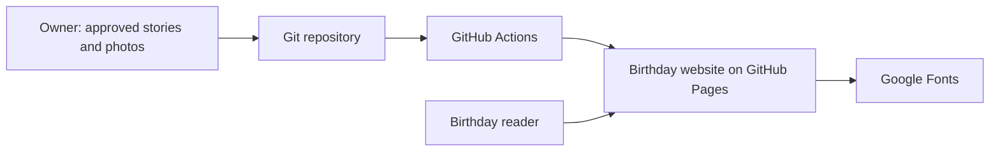
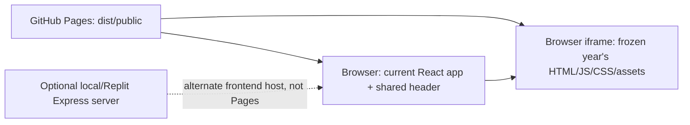
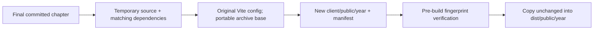

# Sukheswari Diaries

A birthday website that grows by one chapter each year. The homepage is the
latest birthday; choosing an older year opens the independently preserved
website from that year, not a recreation using today's components. The current
chapter is **2026: "The year we got closer"**.[^editions][^viewer]

**Live:** https://agnivadc.github.io/sukheswari-diaries/

**2026 invitation:** https://agnivadc.github.io/sukheswari-diaries/invitation-2026/

**For agents:** start with [AGENTS.md](AGENTS.md), then read this handoff.
For the annual update, jump to the [next-birthday playbook](#next-birthday-playbook).

## What shipped in 2026

The 2026 application was published on 29 October 2026 in commit
`287791fec0fe71af649dbe18b481db99158fc767`.
The [release deployment](https://github.com/agnivadc/sukheswari-diaries/actions/runs/40897571872)
succeeded; this is a release record, not a guarantee of current uptime.

| Edition | Status at this handoff | How to open it |
|---|---|---|
| 2026 | Current, editable; birthday 2 November 2026 | Site homepage |
| 2025 | Immutable standalone build, sourced from `cf6ffc567fb8f56721ec51075a58db2f3074e6d7` | Year dropdown, or `?year=2025` at the site root |

The 2025 source revision and built-file fingerprints are recorded in its
[manifest](client/public/2025/edition.json#L1-L4). It has **not** been replaced
by the new design.

### Experience and design decisions

- **Birthday first:** the large "Happy birthday, Sukheswari." greeting is the
  main headline. The year's relationship-story title is supporting copy.
- **Reading order:** greeting -> secret word -> personal birthday letter ->
  chronological photo story -> wedding countdown. Unlocking scrolls to and
  focuses the letter; there is no timed advance past it.
- **Shared Time design:** deep evergreen, warm ivory, sage, DM Sans and
  Instrument Serif, editorial photography, and decorative synchronising clocks.
  The clocks are a storytelling motif, not live local-time clocks.
- **Seven story groups, ten unique photographs:** January's return and visits,
  ordinary time together, and October's Ashirvad/engagement. The hero reuses a
  timeline photograph. Exact dates and month-only dates retain their different
  precision.
- **Interactions:** lazy-loaded timeline photos, a native dialog lightbox,
  keyboard/focus handling, responsive layouts, and reduced-motion support.
- **Wedding countdown:** midnight India time on 11 February 2027. After the
  target it reads "Our forever has begun."; the date must not be rolled forward
  merely because someone visits an old chapter later.
- **Shared navigation:** older chapters keep the external year dropdown and a
  return link to the current birthday while their own document scrolls.

These are implemented in the [chapter](client/src/pages/Diary.tsx#L1-L436),
[styles](client/src/pages/Diary.css#L5-L18), [font setup](client/index.html#L6-L12),
[countdown](client/src/lib/wedding-countdown.ts#L1-L13), and
[header](client/src/components/DiaryHeader.tsx#L75-L102).
They document the approved 2026 experience, not a requirement to reuse its
visual theme for every future birthday.

The [digital invitation](client/public/invitation-2026/index.html) was added
on 1 November 2026: a separate, photo-free evergreen/ivory card with the exact
button text **"Something for my Love"**. It opens the 2026 chapter without
replacing the homepage or adding another gate. See the
[delivery-card notes](#digital-invitation-and-chat-preview).

## Technical guide

### Stack and entry points

| Layer | Technology / responsibility | Evidence |
|---|---|---|
| Active frontend | React 18, TypeScript 5.6, Wouter 3 | [Manifest](package.json#L66-L77), [TypeScript](package.json#L104), [App](client/src/App.tsx#L1-L49) |
| Build and styling | Vite 5.4, Tailwind 3.4; scoped `Diary.css` for the current chapter | [Manifest](package.json#L102-L105), [Vite config](vite.config.ts#L7), [Diary styles](client/src/pages/Diary.css#L5-L18) |
| Production host | Static GitHub Pages deployment from `dist/public` | [Workflow](.github/workflows/deploy.yml#L17-L42) |
| Optional server | Express 4 + Vite in development, static serving after a full build | [Manifest](package.json#L57), [Server](server/index.ts#L1-L70), [Vite integration](server/vite.ts#L22-L84) |
| Unused database scaffold | Drizzle/PostgreSQL schema and an in-memory user store; not needed by the birthday site | [Routes](server/routes.ts#L5-L15), [Storage](server/storage.ts#L13-L38), [Schema](shared/schema.ts#L6-L10) |
| External browser dependency | Google Fonts for the current chapter | [HTML](client/index.html#L10-L12) |

The frontend starts at `client/index.html` -> `client/src/main.tsx` ->
`client/src/App.tsx`. `App` selects the edition from the `year` query parameter.
The server entry point is `server/index.ts`; GitHub Pages never runs it.
There are no birthday API endpoints, database writes, background workers, or
server-side authentication in the deployed experience.[^app][^server][^workflow]

### Commands and verification inventory

Run commands from the repository root. Script definitions are in
[`package.json`](package.json#L6-L16); dependency installation and the Pages
build are also used by [CI](.github/workflows/deploy.yml#L24-L34).

| Command | Purpose |
|---|---|
| `npm ci` | Install the committed lockfile on a fresh checkout |
| `./node_modules/.bin/vite --host 127.0.0.1 --port 4175 --strictPort` | Frontend-only development; open `http://127.0.0.1:4175/` |
| `npm run dev` | Original Express + Vite development path; default port 5000 |
| `npm run check` | TypeScript check of application/server/shared source |
| `npm test` | Node test runner via `tsx`; edition/navigation and countdown tests |
| `node --import tsx --test client/src/lib/birthday-editions.test.ts` | Run just the edition/navigation test file |
| `npm run archive:verify` | Verify all checked-in frozen editions |
| `npm run archive:birthday -- 2026 HEAD` | Freeze committed 2026 source; only when preparing its replacement |
| `npm run build:pages -- --base=/sukheswari-diaries/` | Verify archives and build for the actual GitHub Pages base path |
| `./node_modules/.bin/vite preview --host 127.0.0.1 --port 4176 --strictPort --base=/sukheswari-diaries/` | Serve that build at `http://127.0.0.1:4176/sukheswari-diaries/` |
| `npm run build` / `npm start` | Optional frontend + Express build and Node serving, not the Pages deployment |
| `npm run db:push` | Unused database-scaffold operation; **not** part of birthday development/deployment |

There are currently five edition tests and four countdown tests. Test files
run through `npm test`; `tsconfig.json` excludes them from `npm run check`.
There is no configured lint, formatter, documentation-test, or browser-test
command. Do not invent `npm run lint` or assume browser coverage is in CI.
The release used ad-hoc browser checks; those helpers are not committed.
Use the [browser checklist](#browser-checklist) below.[^tests]

**CI scope:** a push to `main` or manual `workflow_dispatch` builds and deploys
Pages. The build verifies archives but does **not** run `npm run check` or
`npm test`; run both before publishing. The workflow does not run on pull
requests. Required checks, branch protection, and review enforcement are
**[UNVERIFIED]**: they are repository settings, not established by this checkout.
[^workflow]

### Code map

| Location | Purpose |
|---|---|
| `client/src/pages/Diary.tsx` | Current chapter's copy, letter, typed `Memory`/`Photo` data, photos, lightbox, countdown rendering |
| `client/src/pages/Diary.css` | Current chapter and shared-header/viewer styles |
| `client/src/App.tsx` | Edition selection, authentication state, base-aware routing, title, explicit not-found page |
| `client/src/lib/birthday-editions.ts` | Current/archived edition registry and URL helpers; archives are newest first |
| `client/src/components/DiaryHeader.tsx` | Shared year dropdown and return-to-current link |
| `client/src/pages/ArchivedBirthday.tsx` | Shared header outside an independently scrolling archive iframe |
| `client/src/components/PasswordGate.tsx` | Courtesy secret-word gate; classic and current inline variants |
| `client/src/lib/wedding-countdown.ts` | Fixed India-time target and pure countdown calculation |
| `client/src/assets/2026/` | Published 2026 WebP assets |
| `client/public/invitation-2026/` | Standalone delivery card and JPG link-preview image; stable, year-pinned URL |
| `client/public/<year>/` | Checked-in immutable HTML/JS/CSS/assets plus `edition.json` |
| `scripts/archive-birthday.mjs` | Committed-revision archive generator and fingerprint verifier |
| `client/src/pages/Home.tsx`, older components, `attached_assets/` | Retained original-era source/assets; not the source of the running frozen 2025 build |
| `server/`, `shared/`, `drizzle.config.ts` | Optional server/database scaffold, not required by Pages |
| `.github/workflows/deploy.yml`, `vite.config.ts` | Deployment and asset/base-path configuration |

Start with the entry points and the [subsystem notes](#subsystem-notes), rather
than treating every installed package or legacy component as an active feature.

### Deployment and runtime surface

| Surface | Checked-in configuration | Meaning |
|---|---|---|
| GitHub Actions | `ubuntu-latest`, Node `20` | Build-time Node pin; only static output is deployed |
| Original Replit setup | `nodejs-20`, `postgresql-16`, `stable-24_05`; build/start commands | Retained alternate-host configuration, not evidence that production uses Replit/PostgreSQL |
| Local/optional Node server | No `engines`, `.nvmrc`, container, or other checked-in Node-version pin | Do not assume a developer's installed version matches CI |
| GitHub Pages | Browser executes the built JavaScript | No production Node process or database to provision |

See the [workflow](.github/workflows/deploy.yml#L17-L34),
[Replit configuration](.replit#L1-L26), and [manifest](package.json).

**Maintenance follow-up, not implemented here:** Node 20 is EOL according to the
[official Node.js release list](https://nodejs.org/en/about/previous-releases)
(remote source checked 29 October 2026). Plan and verify a supported build
runtime before the next annual release, aligning CI and any retained Replit
runtime settings. Other dependency support/EOL status is **[UNVERIFIED]**; this
handoff is not a dependency/security audit. Never rebuild a frozen edition as
part of routine toolchain maintenance.

## Context and working rules

### Checkout identity

| Field | Baseline for this handoff |
|---|---|
| Repository | `https://github.com/agnivadc/sukheswari-diaries.git` |
| Branch | `main` |
| Application snapshot | `287791fec0fe71af649dbe18b481db99158fc767` |
| Package identity | `rest-express`, version `1.0.0`; declared license `MIT` |

The snapshot above anchors the 2026 implementation. When freezing it next year,
use the **final approved 2026 commit**, not automatically this first release.
The package identity comes from the [manifest](package.json#L1-L5).

### Documentation precedence and gotchas

This README and [AGENTS.md](AGENTS.md) are the current handoff.
[DEPLOYMENT.md](DEPLOYMENT.md#L5-L46) expands the archive/deployment procedure.
**Resolved historical mismatch:** [replit.md](replit.md#L1-L43) and
[design_guidelines.md](design_guidelines.md#L1-L39) describe the original
2025 experience. Their pastel palette and old component list must not override
the 2026 `Diary` implementation. No sibling services are needed for Pages.

The optional Drizzle command expects `DATABASE_URL`; the static birthday build
does not. Do not provision a database or run migrations to make this website
work. The optional Express server uses port 5000 and `reusePort`; the direct
Vite command above avoids that server when only the frontend is needed.
[^server]

### Non-negotiable rules

1. **Past editions are immutable.** Never edit, regenerate, or overwrite
   `client/public/<year>/` after it is frozen. Never rewrite its fingerprints
   to hide a changed file. Investigate failures and recover the verified
   archive from version control with the owner's approval.
2. **Freeze the outgoing committed chapter before replacing it.** Preserve
   the Git history and lockfile associated with its recorded source commit.
   The archiver cannot capture uncommitted changes.
3. **Keep navigation outside history.** Use the shared viewer and URL helpers,
   not a new navbar injected into a frozen bundle. Cross-year links must escape
   the iframe with `target="_top"`.
4. **Do not invent personal content.** Obtain the year's moments, dates,
   photographs, letter notes, and design approval. Do not infer exact dates
   from ambiguous filenames or manufacture milestones.
5. **Publish only approved assets.** Keep raw originals local, create optimized,
   metadata-stripped copies for the site, and include meaningful alt text.
   A local root `2026/` folder of originals is not the archive directory and
   was not included in the 2026 commit. Avoid blanket `git add .`.
6. **The gate is not privacy/security.** Source and deployed assets are public.
   `sessionStorage` and `noindex` do not make a static site confidential.
   Never commit credentials or assume the secret word protects photographs.
7. **Publishing needs owner approval.** Pushing `main` changes the live site.
   Review the exact staged files and update this handoff with each annual
   rollover.[^archive][^header][^gate][^workflow]

## Architecture

### Level 1: system context



### Level 2: runtime containers



### Level 3: representative navigation lifecycle

```mermaid
sequenceDiagram
  participant Reader
  participant App
  participant Editions
  participant Pages
  App->>Editions: findBirthdayEdition(query year)
  alt Current birthday
    App-->>Reader: Greeting and courtesy gate
    Reader->>App: Correct secret word
    App-->>Reader: Focus letter; allow timeline and countdown
  else Known archive
    App-->>Reader: Shared header and archive viewer
    App->>Pages: iframe GET /year/
    Pages-->>Reader: Independent frozen document
  else Unknown year
    App-->>Reader: Explicit not-found page
  end
```

These views describe the [router](client/src/App.tsx#L13-L43),
[edition registry](client/src/lib/birthday-editions.ts#L1-L32),
[viewer](client/src/pages/ArchivedBirthday.tsx#L4-L18), and
[deployment](.github/workflows/deploy.yml#L17-L42). Runtime content lives in the
browser; the optional server/database scaffold is not a hidden dependency.

### Layering and cross-cutting concerns

Pages compose components and pure `lib` helpers. Edition metadata drives the
header/viewer; the archive itself has no dependency on current component code.
TypeScript enforces types, and pre-build fingerprints enforce archive integrity.
There is no custom architectural-boundary linter.[^app][^archive][^tests]

| Concern | Current mechanism |
|---|---|
| Authentication/state | Case-insensitive client gate; `sessionStorage["authenticated"]` shared by same-origin editions in the tab; React state controls current content |
| Configuration | `import.meta.env.BASE_URL` plus explicit edition metadata; no feature-flag service |
| Content/storage | Typed source literals and imported assets; no birthday API or persistent content database |
| Error handling | Gate validation, unknown-year not-found page, archive/build errors fail explicitly |
| Logging/telemetry | Optional Express API console logging; no application analytics/metrics/tracing configured in the active birthday entry points |
| Accessibility | Semantic headings, skip links, dialog/focus handling, reduced-motion CSS |

Sources: [gate](client/src/components/PasswordGate.tsx#L11-L59),
[App](client/src/App.tsx#L13-L43), [chapter](client/src/pages/Diary.tsx#L221-L436),
[motion styles](client/src/pages/Diary.css#L1256-L1273), and
[server](server/index.ts#L9-L47).

### Implemented architectural decisions

- **Snapshots, not shared historical React pages:** source commits plus
  standalone builds preserve old styling/content even as the current stack
  changes.[^archive]
- **Query-string archive viewer:** `?year=2025` needs no Pages SPA rewrite.
  An iframe isolates old CSS/JavaScript while an external header provides a
  way back.[^editions][^viewer]
- **Static hosting:** the shipped story is source/asset driven; the retained
  Express/database scaffold does not justify adding a backend.[^server][^workflow]

These summarize implemented decisions. Broader rationale beyond the preservation
and navigation requirements is **[INFERRED]**, not a separate formal ADR history.
CI build/integrity checks are implemented; enforced review/merge governance
remains **[UNVERIFIED]**.

## Subsystem notes

### Archive creation, integrity, and viewing

`archive-birthday.mjs` resolves a Git commit, extracts it into a temporary
workspace, uses that revision's lockfile/Vite configuration, and builds with
relative assets. It reuses installed dependencies only when lockfiles match;
otherwise it installs the extracted revision's dependencies. A deployment-only
runtime base lets the unchanged application route beneath a year directory.
`publicDir: false` prevents recursively nesting older archives. The generator
writes `edition.json` with `year`, `sourceCommit`, and SHA-256 `files`, refuses
an existing destination, and cleans up its temporary workspace.[^archive]



Normal navigation uses `getEditionHref`; raw iframe URLs use
`getArchiveSource`. Helpers remove the frozen-year suffix from a runtime base
when linking back to the shared site. The current chapter hides its own header
when embedded, so a future frozen 2026 chapter will not show two headers.
The newest archive must be first in `archivedEditions`, because the footer
uses the first entry.[^editions][^viewer][^header][^diary]

Use `/2025/` for the raw directory URL, not `/2025/index.html`: the original
router expects its directory base. The Vite dev middleware serves these
directory entry pages rather than falling through to the current SPA.
[^vite][^archive]

Snapshots pin application code and local assets, not the clock, browser
rendering, or external font responses. Both the [2025 HTML](client/public/2025/index.html#L10-L12)
and current HTML request Google Fonts. Date-dependent features continue to
behave as originally written; freezing a chapter does not freeze time.

### Current chapter, authentication, photos, and time

`Diary.tsx` keeps `Memory` and `Photo` data local to the chapter. Unlocking
sets the existing session flag, renders the letter/timeline, and intentionally
focuses the letter rather than skipping straight to photos. Already-unlocked
visits use a letter link. The dialog owns photo selection and restores body
scrolling when closed; visual reveals respect reduced motion.[^diary][^gate]

The countdown helper takes an injectable `now`, rounds remaining partial seconds
up, clamps at zero, and exposes `hasArrived`. Its tests cover the India-time
boundary and post-date behavior; do not replace the target with a browser-local
date string. This is 2026-specific content, not a permanent countdown template
for 2027.[^countdown][^tests]

### Digital invitation and chat preview

[`client/public/invitation-2026/index.html`](client/public/invitation-2026/index.html)
is self-contained HTML/CSS, separate from the React application. Its real link
uses `../?year=2026`, so the gift continues to select 2026 after a later chapter
becomes the homepage. There is no photo, voice recording, PDF, or QR code.

`preview.jpg` is a 1200 x 630 JPEG used by the page's Open Graph/Twitter metadata.
It is a sharing asset, not a clickable image file. Chat-preview appearance
depends on the messaging app and its cache; the invitation's actual button
works independently of the preview. If the card design changes, update the JPG
and its metadata together.

Normal Pages builds copy this folder unchanged. The archive tool deliberately
excludes public folders from each standalone chapter build, so an invitation
is **not** nested inside a future `client/public/2026/` snapshot. Keep the
year-specific invitation folder and preview image in the repository when adding
later birthdays; never repoint an already-sent 2026 card to the newest year.

## Next-birthday playbook

The agreed long-term plan is **one new birthday chapter per year, with every
previous site preserved**. The next chapter is 2027. Its title, visual direction,
moments, letter, and any closing feature have **not** been decided.

### 1. Collect and approve the new brief

Confirm the birthday year/date, the year's important moments, approved photos
and captions, uncertain dates, birthday-letter pointers, and desired design.
Ask whether to retain or replace the current reading order. Do not automatically
carry the 2026 wedding countdown into a later chapter.

### 2. Freeze 2026 before changing application code

Start from the final approved, committed 2026 application. A planning branch is
fine; do not let uncommitted or already-started 2027 changes become the archive.

```bash
git switch -c birthday/2027
npm run archive:birthday -- 2026 HEAD
npm run archive:verify
```

`HEAD` must still represent the final 2026 chapter. If `client/public/2026/`
already exists, **do not regenerate it**: verify it and investigate its manifest
instead. Review and retain the generated archive alongside the new chapter;
do not include the separate root folder of raw originals.

### 3. Build the new current chapter

1. Set `currentEdition` to 2027 and register 2026 above 2025 in
   `archivedEditions`. Keep known archives available.
2. Implement the approved 2027 chapter in the active page/styles, or replace
   the active page deliberately and update `App.tsx`. **Changing the registry
   alone does not update the hardcoded 2026 copy, dates, photos, or countdown.**
3. Add approved optimized assets in a new year-specific asset folder. Preserve
   raw originals and use accurate alt text/captions.
4. Update `client/index.html` title, description, fonts/theme if needed, and
   year-specific test expectations. Keep unknown-year rejection, base-path
   coverage, archive-manifest coverage, and top-level cross-year navigation.
5. Keep shared navigation outside the snapshots. A changed global header may
   change the viewer chrome, but not the historical document inside it. Retain
   embedded-header suppression and top-level cross-year links in a new current
   page so it can also be archived safely the following year.
   Preserve already-sent year-specific invitations and their matching-year links.
6. Update this README and agent handoff with what shipped and the next open
   decisions. Do not silently introduce a redesign, backend, hosting migration,
   or dependency overhaul without approval.

### 4. Verify, then publish with approval

```bash
npm run check
npm test
npm run build:pages -- --base=/sukheswari-diaries/
```

Both production build scripts already run archive verification. Preview the
actual Pages-base build using the command in the inventory; do not validate
only a root-path dev server.

After review and owner approval, commit only the intended files and push to
`main`. That push triggers the Pages workflow; a successful push alone is not a
successful deployment. Wait for the matching commit's build **and** deploy jobs,
then repeat the essential checks at the live HTTPS URL. See
[DEPLOYMENT.md](DEPLOYMENT.md) for deployment details.

### Browser checklist

- Fresh visit: correct dominant birthday greeting; letter/timeline gated;
  invalid secret word gives feedback; successful unlock focuses the letter.
- Letter-to-timeline flow is reader-controlled; all approved images load.
- Lightbox opens/closes with Escape and returns focus; reduced motion works.
- At 320, 390, 768, and 1440 px, no horizontal overflow or clipped navigation.
- Every archived year opens with one shared header, the correct selected year,
  and a visible return-to-current link; the header stays visible while scrolling.
- Archive gate works on a fresh session; returning to the current year reuses
  the tab's authentication. Test direct viewer URLs, reload, and Back/Forward.
- Test each raw `/year/` URL and unchanged original styling/content. The raw
  2025 page intentionally has no new shared header; test return navigation in
  the viewer, without duplicate headers or nested archive viewers.
- Check unknown years show not-found, countdown boundaries if retained, and
  archive integrity. On production, confirm asset requests succeed and
  deployed archive bytes match the checked-in manifest, not just HTTP 200.
- Check the invitation on narrow screens, keyboard focus, and reduced motion.
  Its button must say "Something for my Love" and open `?year=2026`; its
  preview-image URL must return the matching JPEG. Keep this check when adding
  later years so the old invitation still selects its original chapter.

### Starter prompt for next year's agent

```text
Read AGENTS.md, README.md, and the Birthday editions section of DEPLOYMENT.md.
Help me prepare the 2027 birthday chapter. First summarise the current
architecture, preservation rules, files to change, and information you need.
Ask me for the new moments/photos, confirmed dates, letter notes, and design
direction; do not invent personal facts.
Before modifying the current application, preserve the final approved,
committed 2026 chapter with the existing archive tool. Never change a frozen
edition or its fingerprints. Add 2027 as the current chapter and keep both
2026 and 2025 accessible through shared navigation.
Show me the local result, run the documented checks and browser checklist,
and update the handoff. Do not commit, push, or deploy until I approve.
```

## Confidence and remaining decisions

| Area | Confidence / status |
|---|---|
| Current routing, content, archive implementation, commands | **High**: verified against the linked source files |
| 2025 preservation | **High**: recorded source commit and fingerprints; all 22 deployed files matched during the 2026 release |
| 2026 deployment | **High as of 29 October 2026**: linked successful release run; not a current uptime check |
| Architectural rationale | **Implemented behavior verified; broader rationale inferred** |
| 2027 content/design/closing feature | **Undecided**: owner input required |
| Node 20 lifecycle | **High, remotely sourced**: official EOL listing checked on the handoff date |
| Other dependency support, branch protection, required reviews/checks | **Unverified** |

## Source notes

[^editions]: [client/src/lib/birthday-editions.ts:1-32](client/src/lib/birthday-editions.ts#L1-L32) establishes the registry, ordering, selection, and root/archive URL helpers.
[^app]: [client/src/App.tsx:13-49](client/src/App.tsx#L13-L49) establishes base-aware rendering, session state, and unknown-year handling; [client/src/main.tsx:1-5](client/src/main.tsx#L1-L5) is the browser bootstrap.
[^diary]: [client/src/pages/Diary.tsx:19-436](client/src/pages/Diary.tsx#L19-L436) defines the typed story data, embedded mode, letter-first flow, photos, and countdown UI.
[^viewer]: [client/src/pages/ArchivedBirthday.tsx:4-18](client/src/pages/ArchivedBirthday.tsx#L4-L18) places the shared header outside the original document's iframe.
[^header]: [client/src/components/DiaryHeader.tsx:10-102](client/src/components/DiaryHeader.tsx#L10-L102) establishes selection, return navigation, top-level links, and menu keyboard/outside-focus behavior.
[^archive]: [scripts/archive-birthday.mjs:22-135](scripts/archive-birthday.mjs#L22-L135) establishes fingerprint verification, committed-source extraction, independent builds, overwrite refusal, and cleanup.
[^vite]: [vite.config.ts:7-25](vite.config.ts#L7-L25) serves frozen directory indexes in development; the remainder sets aliases and the `dist/public` build destination.
[^gate]: [client/src/components/PasswordGate.tsx:11-59](client/src/components/PasswordGate.tsx#L11-L59) establishes the courtesy gate/session flag; [client/index.html:8](client/index.html#L8) requests no indexing.
[^countdown]: [client/src/lib/wedding-countdown.ts:1-13](client/src/lib/wedding-countdown.ts#L1-L13) establishes the fixed timezone, rounding/clamping, and injectable clock.
[^tests]: [package.json:11-14](package.json#L11-L14), [tsconfig.json:2-3](tsconfig.json#L2-L3), [edition tests](client/src/lib/birthday-editions.test.ts#L12-L50), and [countdown tests](client/src/lib/wedding-countdown.test.ts#L5-L35) establish the available automated checks.
[^server]: [server/index.ts:1-70](server/index.ts#L1-L70), [server/routes.ts:5-15](server/routes.ts#L5-L15), [server/storage.ts:13-38](server/storage.ts#L13-L38), and [drizzle.config.ts:3-13](drizzle.config.ts#L3-L13) distinguish the optional scaffold from the static site.
[^workflow]: [.github/workflows/deploy.yml](.github/workflows/deploy.yml#L3-L42) establishes main-push/manual triggers, runtime setup, verified build, artifact upload, and the subsequent Pages deploy job.
